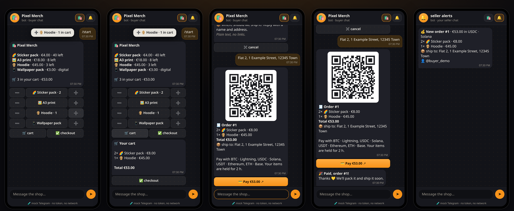
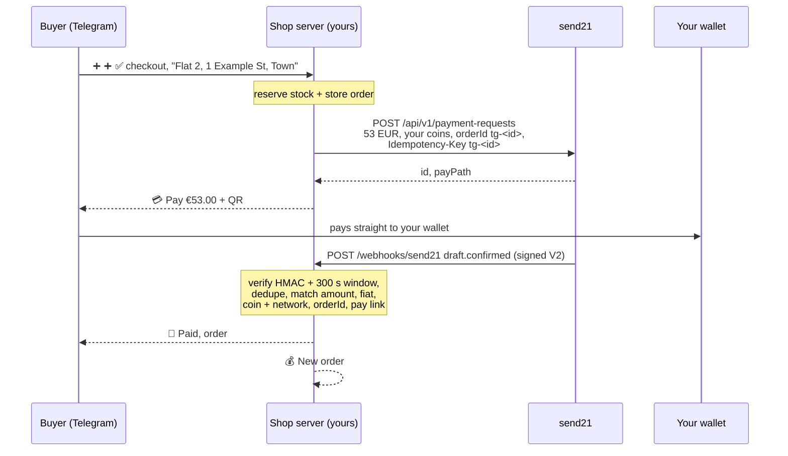

# send21 telegram shop 🛍️

**A tiny Telegram shop bot for stickers, prints and a hoodie: tap ➕, check out, pay with crypto, get 🎉.** Built on [send21](https://send21.io), crypto pay links and API for people and AI agents.

<p></p>

<sub>Mock-mode screenshots (📱 local phone page), not real payments.</sub>

- 🛒 A catalog from `products.json` with ➕ ➖ 🛒 ✅ buttons, stock that is reserved at checkout and put back when a link expires or is declined
- 💳 One send21 pay link per order, priced in fiat: buyers pay in BTC (on-chain or ⚡ Lightning), USDC, USDT, EURC, SOL or ETH, whichever you add
- 🔒 Non-custodial: money goes from the buyer's wallet straight to yours. 🎉 for the buyer and 💰 for you only after your server checked the payment

## Quickstart

1. **Try it now, no keys at all:** `npm install && npm run dev`, open http://localhost:3000/phone and type `/start`. Mock Telegram + mock send21: add items, ✅ check out, tap 💳 Pay, then ✅ pay on the mock page (or try ⚠️ short → 👍 accept / ↩️ decline, or ⌛ expire) and go back to the chat. The 🔔 tab is the seller's chat.
2. **Telegram bot.** Create one with @BotFather and put `TELEGRAM_BOT_TOKEN` in `.env` (`cp .env.example .env`). Run it, send `/whoami` to your bot and put that number in `ADMIN_CHAT_ID`.
3. **send21 key and addresses.** On [send21.io/api-keys](https://send21.io/api-keys), create a key with `drafts:write` (add `webhooks:manage` for step 4). Set `SEND21_API_KEY` and your own receiving addresses: `PAY_LIGHTNING=you@your-wallet.com` and/or `PAY_OPTIONS=usdc-sol:<address>,usdt-eth:<address>`.
   - 🔐 **Approve your receiving addresses in send21.** New send21 accounts (created on or after 20 Oct 2026) only accept receiving addresses the owner approved, including Lightning addresses. Add them in the send21 app, or propose one from an agent (MCP `propose_receiving_address`), then sign in and approve it with a passkey or authenticator code. No API key can approve an address. Older accounts can opt in under Settings.
4. **Webhook.** Put the server behind your own HTTPS address (`PUBLIC_URL`, for example a reverse proxy with a free Let's Encrypt certificate and `TRUST_PROXY=1`), then `npm run webhook:register` and paste the printed `SEND21_WEBHOOK_SECRET` into `.env`.
5. **Your products and go.** `cp products.example.json products.json`, edit it, then `npm run build && npm start`. Long polling by default; for a Telegram webhook set `TELEGRAM_WEBHOOK_URL` + `TELEGRAM_WEBHOOK_SECRET`.

```json
{ "sku": "hoodie", "name": "Hoodie", "emoji": "🧥", "price": 45, "stock": 3, "photo": "https://…/hoodie.jpg" }
```

`price` is in the shop `currency`, `photo` (https) is optional and shows when the buyer taps the product, `"digital": true` skips the address.

## How it works

`/start` shows the catalog. ➕ and ➖ edit that one message in place. **✅ checkout** freezes the cart under a fresh order id and asks for a shipping note (📦 digital is offered, and accepted, only when every item in the cart is digital). When the note arrives, the server reserves the stock and stores the order in **one write**, then creates **one** send21 payment request for the order total, priced in fiat, with `orderId` `tg-<id>` that is also the `Idempotency-Key`. The bot sends a 💳 Pay button and a QR of the same link. The buyer pays on the send21 pay page from their own wallet.



| Webhook | Order | Stock |
| --- | --- | --- |
| `draft.seen` | 👀 seen | held |
| `draft.confirmed`, matches the order | ✅ paid (🎉 buyer, 💰 you) | sold |
| `draft.confirmed`, does **not** match | 🚩 flagged, never paid (you get the reasons) | held |
| `draft.amount_mismatch` → `mismatch_accepted` / `mismatch_rejected` / `mismatch_unresolved` | ⚠️ review → 👍 / ↩️ declined / ⚠️ unresolved | held / held / **back** / held |
| `payment_request.expired`, `draft.expired`, or the local sweep | ⌛ expired | **back** |

A late payment after expiry still counts as paid, and your 💰 alert says to check stock first, because those items may have been sold again. Payments up to `SHOP_SHORTFALL_PERCENT` (default 1%) short are accepted through send21's `shortfallPolicy`; other amounts wait for you to accept or decline them on send21. Each chat can have `SHOP_MAX_OPEN_ORDERS` (3) unpaid orders, and links live `SHOP_EXPIRY_HOURS` (2).

**⚡ Lightning.** send21 fetches an invoice from your Lightning address and confirms the payment when your wallet provider supports **LUD-21**. Without it the money still reaches you, but the order is not confirmed on its own. See [Lightning](https://send21.io/docs/lightning).

**Modes.** No `TELEGRAM_BOT_TOKEN` = mock Telegram (📱 `/phone`, bound to localhost). No `SEND21_API_KEY` = mock send21 (pay links open a local simulator that sends really signed webhooks). A real token with mock send21 works too, but the 💳 button then points at `PUBLIC_URL`, so it must be reachable from the buyer's phone.

**Fees.** One small send21 fee per paid order (0.49% on small payments, at least $0.01), never taken from the payment. See [pricing](https://send21.io/pricing).

## Troubleshooting

- **422 `address_not_approved`:** a receiving address isn't approved in your send21 account, so nothing was created. Sign in to send21, approve the address (passkey or authenticator code), then try again.

## Security notes

- **Signature V2 only.** Every delivery is checked with `X-Send21-Signature-V2`: HMAC-SHA256 over `<t>.<delivery id>.<raw body>`, constant-time compare, refused when more than **300 s** old or in the future. A bad signature gets `401` and nothing is stored.
- **Dedupe on both sides.** send21 dedupes on its side (retries reuse the same `X-Send21-Delivery` id, and the `Idempotency-Key` makes one order one link). The shop server still runs its own duplicate check: a delivery id, or the same body under a new id, is applied once. The delivery id and the order change are written together before the `2xx`, so a restart cannot apply it twice; a failed write answers `500` so send21 retries. Buyer and seller messages go out only after that write.
- **The shop's server checks amount and asset against the order.** A `draft.confirmed` must match the stored order: `orderId`, pay link id, `status: Confirmed`, a txId, the fiat currency, the exact total (in cents), and a coin **and** network that order offered. Anything else is 🚩, never paid. Paid is final; late or out-of-order events never undo it. Other apps' orders on the same send21 account are ignored.
- **Prices come from your server.** Carts hold only skus and counts; prices, totals and stock come from `products.json` and are checked inside the same write that reserves them, so two buyers can never both get the last hoodie.
- **Telegram.** Private chats only. Webhook mode checks Telegram's secret token header. Shipping notes are plain text (no links or markup, max 200) and every dynamic string is HTML-escaped. `/orders` answers only your `ADMIN_CHAT_ID`. Addresses are personal data: they stay in your `DATA_FILE` (mode 600) and your admin chat, never in send21's memo.
- **Your addresses only.** Receiving addresses are shape-checked per network; send21 never asks for a seed phrase or private key, and a send21 key cannot move funds. The key is never logged.
- **Hardened web side.** Strict CSP (`'self'`, no inline script or style), `frame-ancestors 'none'`, tiny body limits; the 📱 phone page renders with `textContent` only.
- **Data.** One JSON file, written atomically. For several processes, use SQLite or Postgres.

## Develop

```bash
npm run check   # typecheck + lint + tests: signature, dedupe, restart, order matching, stock, idempotency, bot flow, phone API
```

API reference: [send21.io/docs](https://send21.io/docs) · [quickstart](https://send21.io/docs/quickstart) · [webhooks](https://send21.io/docs/webhooks) · [llms-full.txt](https://send21.io/llms-full.txt). More examples: [send21-examples](https://github.com/send21io/send21-examples).

Questions: [info@send21.io](mailto:info@send21.io). License: [MIT](LICENSE).
